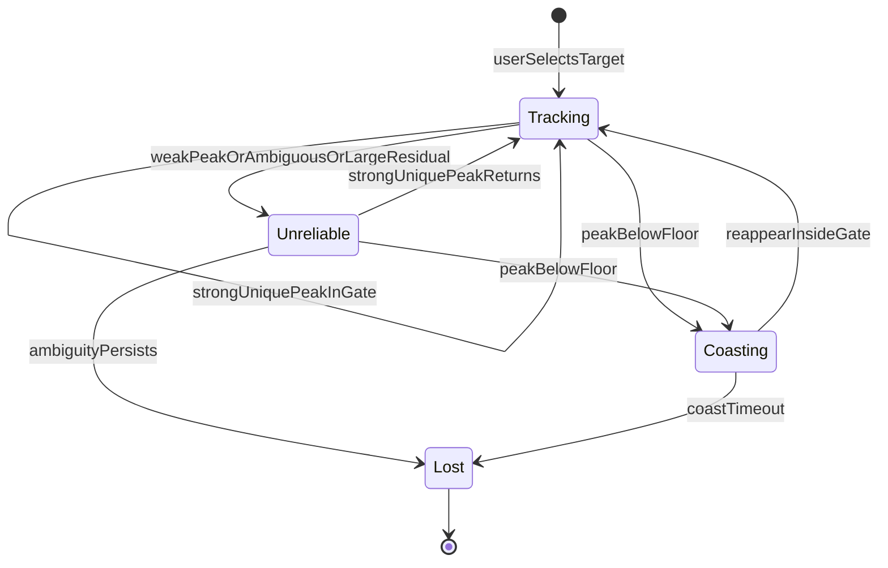

# Constraints

Binding limits for the thermal lock. [README.md](README.md) describes the lock that runs today on the LWIR board.

## One target

Lock onto one object, selected once by the user. The plane is linear thermal counts or degrees.

Each processed frame reports the target center in the active sensor image and a confidence in `[0, 1]`. When the lock is ambiguous or gone, report that state and stay off every other heat source.

These stay in force on every platform:

- Local contrast against the surroundings, including when the target is cooler than the background and its shape remains.
- A motion gate around the prediction.
- A frozen anchor taken from the original selection.
- An explicit second-peak test.
- The states `tracking`, `unreliable`, `coasting`, and `lost`.

The measurement uses the temperature class that differs from the window edge. A global change of the display window is the same target: correlation removes a brightness offset and a positive scale. Counts on the TEMP tap rise with temperature. The raw IR tap falls with temperature, and the tracker leaves that tap unused.

A window whose standard deviation sits near the sensor noise floor has no contrast. The matcher skips it.

"Briefly hidden" is a time, about 0.5–1.0 s, measured with timestamps. At 120 fps that is roughly 60–120 frames. At 15 fps it is roughly 8–15 frames. The same hide duration behaves the same at both rates. Coasting decay is per second.

### Selection

The user selects a point `(x, y)` in full-frame coordinates of the active mode, or a box. A point grows the connected component of similar relative temperature. A box skips region growing.

If that window already contains two similar blobs, start in `unreliable`.

### Association

- A peak that is strong, unique, and inside the gate updates position. Velocity blends in with a low gain. The live filter may update.
- A second peak comparable to the first (ratio above about 0.75) and spatially separate: hold the prediction, mark `unreliable`, and step toward neither blob. If the ambiguity persists for about 0.3 s, mark `lost`.
- A peak below the floor enters `coasting` and follows the motion model only. The filter stays unchanged while the state is `coasting` or `unreliable`.
- The original selection remains the anchor. If the live appearance's correlation with that anchor falls through a floor, freeze further filter updates. Reject a measurement that matches a distractor better than it matches the anchor.

### Confidence and output

Confidence in `[0, 1]` is the product of peak-to-sidelobe strength, uniqueness (`1 - second/first`), and agreement with the predicted position. Coasting multiplies that product by a decay per second.

Every processed frame emits:

- `x`, `y` — target center in active-mode image pixels, subpixel while the lock is valid
- `confidence` — float in `[0, 1]`
- `state` — `tracking`, `unreliable`, `coasting`, or `lost`
- crop origin and bin factor, so the point maps back to the sensor frame

`x` and `y` use the coordinate system of the sensor mode the user selected. Convert crop pixels back through the bin and the crop origin. Publish the scale and origin with the stream so a consumer can invert the mapping.

On `lost`, emit `confidence=0` and publish no new lock point. Width, height, and velocity may be emitted for tuning.

Center error counts only while the state is `tracking`. A smooth path that has swapped onto another heat source is a failure.

## Platform

The board is an STM32N6: Cortex-M55, Neural-ART accelerator at about 600 GOPS, on-chip SRAM of a few megabytes, and 64 MB of external RAM. The sensor is thermal and captures 256x192 frames at 12 FPS without any processing.

## LWIR board

The live camera is the Cormorant LWIR board and its InfiRay Tiny1-C, 256×192. It exercises translation, scale, turn, short and long occlusion, a second similar heat source, cooling, and background warming. The target should land at a few tens of pixels across, which is the same situation as the N6 crop.
