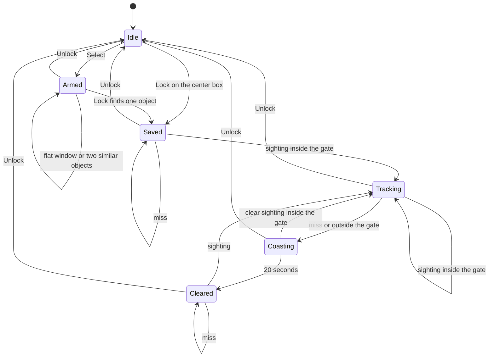
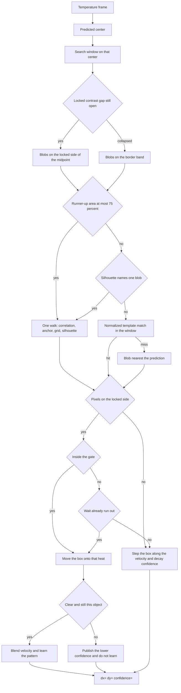
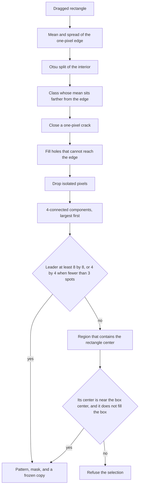
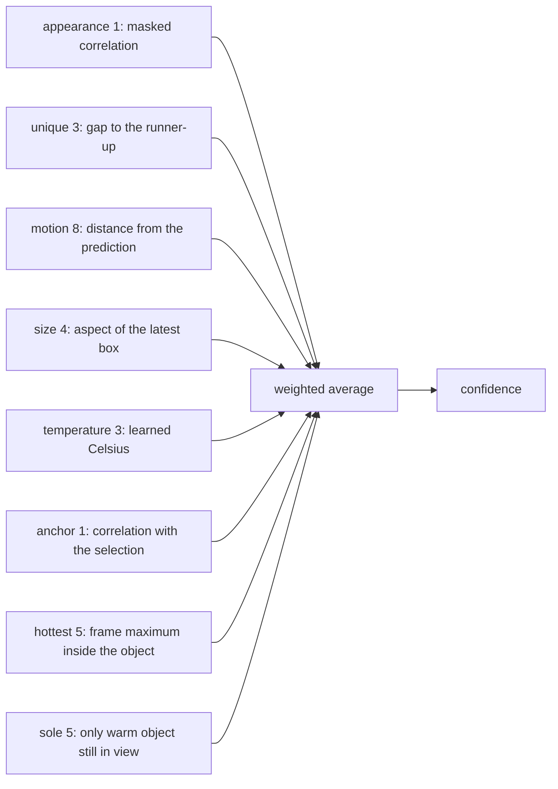

# Introduction

This project was developed during the European Defense Tech Hub hackaton in Sofia, Bulgaria.

# Locke

Locke follows one object in a thermal image. Lock takes the object inside the center box. Select, then drag a rectangle, to choose another. Each later frame reports where that object sits, and a confidence from 0 to 100.

```
python track.py
python track.py -p /dev/cu.usbmodem123
python track.py --no-open
python track.py --debug
python track.py --record
```

`track.py` builds `omvcon`, copies the tracker onto the camera card, and opens a browser view of the live frame. Lock uses the center box. Select, then drag, to choose another. `--record` writes those frames to `assets/track-YYYYMMDD-HHMMSS.mp4`. The camera is the Cormorant LWIR board and its InfiRay Tiny1-C: 256×192 at 12 frames per second with no computation on the frame, sensor id `0x2121`, temperature plane in kelvin times 64. That span is mapped onto the 8-bit image the matcher sees. One frame is 83.3 ms.

The console prints `diff x= y=` for a live sighting. `--debug` also prints the cue line and the lock. A box whose center is `(140, 92)` on a 256×192 frame, with correlation 80 and a runner-up of 10, prints this with `--debug`:

```
appearance=80 appearance_us=… unique=88 unique_us=… motion=na motion_us=… size=100 size_us=… temperature=na temperature_us=… anchor=na anchor_us=… hottest=na hottest_us=… sole=na sole_us=…
dx=12 dy=-4 confidence=93
track=LOCKED
diff x=12 y=-4
```

Without `--debug` that frame prints:

```
diff x=12 y=-4
```

`dx` and `dy` are pixels from the middle of the frame to the middle of the box. Right and down are positive. `confidence` is the weighted average of the cues that voted. Here the latest box has the same aspect, so size is 100, and appearance 80, unique 88, and size 100 average to `(80×1 + 88×3 + 100×4) / 8`. A cue prints `na` when it abstains. Each `*_us` field is that cue's cost in microseconds. On a live frame the crop is present, so anchor and temperature vote as soon as they have data. Hottest votes 100 only when this object holds the frame's maximum gray count.

A live sighting prints `diff x= y=` and sends the same offset as a MAVLink `LANDING_TARGET` on UART 3 (P4 TX, 115200). `x` and `y` are the signed pixel offsets, right and down positive. The angles are the arctangent of the pixel offset through the 3.2 mm lens, 56° by 42°. A coast, a lost lock, and the frames before the first sighting print no diff line and send no packet.

The limits for the STM32N6 port are in [CONSTRAINTS.md](CONSTRAINTS.md).

## Where the lock can be



Lock saves the pattern immediately and draws that object box. The readout is the offset of that box from the middle of the frame, with confidence 0, until a sighting is scored. A miss before that leaves the box where it was saved and keeps the offset. `Tracking` draws the box on the latest heat inside the gate and is reported as `LOCKED`. The gate is what makes it that target: a weak score, and a neighbor of similar size, still move the box onto the heat under it and publish the lower confidence, without learning and without starting the twenty seconds. A clear sighting publishes a full confidence and learns. `Coasting` is `COASTING`: the box steps by the recorded velocity, the readout follows that point, and the confidence fades. A hotter point inside the gate does not move it. The box leaves that path only when a sighting matches the stored size, shape, and heat. `Cleared` is `LOST`. It publishes `dx=0 dy=0 confidence=0` and hides the box. The pattern is still in memory, so a later sighting takes the lock up again and the state returns to `LOCKED`. With no saved object the report is `NA`. Unlock deletes the pattern file.

A shutter correction holds velocity and is left out of the twenty seconds. The module's automatic shutter is off. The script closes the shutter when the sensor temperature has moved by 20 counts after at least 10 seconds, or when 120 seconds have passed.

## One frame



The search stays inside the window, and so does a miss.

```
+---------------------- 256 x 192 ----------------------+
|                                                       |
|            prediction = last center + velocity        |
|                         *                             |
|              +--------- window ---------+             |
|              |                          |             |
|              |     +---- pattern ----+  |             |
|              |     |                 |  |             |
|              |     +-----------------+  |             |
|              |     margin around it     |             |
|              +--------------------------+             |
|                                                       |
+-------------------------------------------------------+
```

The window is the pattern width and height plus the margin on every side, clamped to the frame. The first window is centered on the selection. Later windows are centered on the drawn box plus its last measured step. When the filter's prediction is further along that same step, that point is used instead. An axis the last step did not move stays on the box, so a camera shift on one axis does not drag the window along an older velocity. A measured step of zero keeps the window on the box. The margin starts at 16 pixels. The last step is added whole, so a fast object still lands inside. Each missed frame after a lock adds 4 pixels. That extra stops at 48, unless the step itself is already larger, in which case the whole step is kept.

```
margin = 16 + max(|vx|, |vy|) + missed frames × 4
```

with the miss term capped as above. A sighting has to sit inside a circle around the drawn center, with that margin as the radius. While coasting, a detection whose size and shape match the lock is taken back even outside that circle. For two seconds that search stays where the coast predicts the object. After two seconds without a match, the whole frame is searched for the stored size, silhouette, and heat signature, and a match there ends the coast. Size and shape outweigh the coast direction. A rectangle more than twice the locked box, or one that has grown out to the frame, is not that object, so the coast box stays the locked size. While the object is hidden, the position advances by the recorded velocity once per frame, so the window and the published point follow that line. If the last sighting did not move, the hide holds the box where it is: a camera shift that has already stopped is not treated as motion. The velocity stays at the last accepted step. At twenty seconds, 240 frames, the state is `LOST`, the box is hidden, and the point stops moving. A sighting after that returns the state to `LOCKED` and draws the box on that heat, including when the heat sits outside the gate.

## Selection

Lock writes the object to `locke.target` on the card (`/sdcard`, then `/sd`). The file holds the frame size, the box, the pattern, and a mask. Pixels outside the object are filled with the temperature of the rectangle's edge, so the surround is flat.



Otsu picks the threshold that maximizes the between-class variance of the gray histogram. Of the two classes, the lock keeps the one farther from the edge mean, when that distance is at least 10 gray levels (or three standard deviations of the edge, when that is larger) and the class covers at least 32 pixels, or 16 when the sparse floor is in use. If neither class qualifies, an interior pixel joins the foreground when it differs from the edge by that same amount. The edge itself stays background.

A one-pixel crack is a background pixel with two or more foreground neighbors among the four adjacent pixels. Closing it keeps a split silhouette as one object. A hole is background that a flood from the rectangle edge cannot reach. An isolated foreground pixel is dropped.

The leader has to be at least 8 pixels on a side and 32 pixels in area. When the frame shows fewer than three heat spots of at least 4 by 4, that floor drops to 4 pixels on a side and 16 pixels in area. That is a distant target: one object far enough to cover only a few pixels, with little else warm in the view. The rectangle's outer pixel is still the surroundings, so the 4 by 4 heat has to sit inside the box. Three or more spots keep the 8 by 8 floor. Anything smaller than 4 by 4 is still refused with `No object can be distinguished`. The runner-up is its area as a percent of the leader. Above 75 percent the selection is refused with `Two objects in the window.`

When the edge mixes a hot window with a cool surround, that distance test finds nothing. The lock then keeps the region that contains the center pixel, which is where the operator aimed the box. That region's own center has to lie within a quarter of the rectangle on both axes, and the region has to be smaller than the rectangle, so a flat surround is not saved as the object. Anything else is refused with `No object can be distinguished`, and any previous pattern is left as it was.

The sign of the contrast is saved here. From the next frame on, pixels inside the band below are the blobs. OpenMV `find_blobs` gathers them and keeps regions of at least 32 pixels. Neighbors stay separate, so a second object remains a second peak. The finder rectangle is the sighting: it is not flooded again in Python. While either side of the locked pattern is under 8, that floor is 16 pixels, and the scale search may try 4. A warmer object locks the high side of the midpoint. A cooler object locks the low side.

```
warmer than the edge          cooler than the edge
255 |  #######                255 |
    |  #######                    |
mid |---------                mid |---------
    |                            |  #######
  0 |                        0   |  #######
    band is mid .. 255           band is 0 .. mid
```

The midpoint is the average of the object mean and the background mean. The band also stays at least 10 gray levels (or three edge standard deviations) away from the latest window border. Polarity stays on the side chosen at selection. If the gap between the two means falls under 10, or that band finds nothing, blob finding uses the border rule. The template match runs when that also finds nothing, and when the runner-up is too large and the stored silhouette does not name one of them. The box that is kept is only the pixels inside the band. A hot lock therefore drops a wide cold patch, and it drops a template hit on the surround. The last center stays.

## Algorithms

### Masked zero-mean normalized cross-correlation

The appearance score is the cosine of the pattern and the crop after each has had its mean removed. Only mask pixels enter the sums. A negative cosine is stored as 0. The result is rounded to an integer from 0 to 100.

```
let f be the crop and p the pattern, on mask pixels

r = dot(f - mean(f), p - mean(p))
    / (|f - mean(f)| |p - mean(p)|)

score = round(100 * r)     when r > 0
score = 0                  otherwise
```

On the camera, the leading blob is scored this way against the live pattern, in one integer walk over the masked pixels. That same walk reads the anchor, the 4 by 4 grid, the object temperature, and the silhouette, so a locked frame does not cross the crop again for each of them. The pattern's energy is kept and updated in place when the pattern blends. Sums stay integers; the cosine is taken once.

The silhouette is stored with the lock: how full the mask is, where its centroid sits in the box, an 8-bin profile of each edge, and which cell of the 4 by 4 is hottest. It is taken from the mask at selection and again when that mask freezes or a distant target adopts a new size. It is not blended every frame.

When the runner-up area is more than 75 percent of the leader, that silhouette picks the blob whose fill and centroid match, if one of them stands clear and the correlation agrees. The template search is skipped on that frame. Otherwise, or when neither the locked band nor the border band finds a blob, the same window is searched with OpenMV `find_template` (normalized correlation, threshold 0.25, step of 2 pixels). The hit is kept only when its pixels sit in that same band. When the template misses and this is not a coast, the blob nearest the prediction is the target, so a neighbor of the same size does not freeze the selection in the image. Other blobs that sit apart from it are scored too, and the stronger of them is the runner-up. While coasting, a blob whose fill and centroid both miss the silhouette is not read. The anchor correlation is that same walk, and it is shared with the distractor check.

A sighting is clear when the score is at least 50 and the runner-up is at most three quarters of the leader (`second × 4 ≤ score × 3`). A clear sighting inside the gate learns the pattern. Any other blob inside the gate still moves the box onto that heat, including a score under 50 and a similar neighbor, and the twenty-second timer does not run. A miss or a sighting outside the gate leaves the box where it was and starts that timer. Before the first sighting the readout is the offset of the saved box and the confidence is 0.

`logic.search_scales` is the gray-buffer form of the same score. It tries the pattern at 85, 100, and 115 percent of the last box, resized with nearest neighbors, and keeps the best score. A tie keeps the larger area. The camera loop takes the blob's own width and height as the sighting size.

### Constant-velocity filter

The position gain is 1, so an accepted sighting places the state on the measured center. The velocity gain is 1 on the first step and 1/2 after that. The half rounds toward zero, so a shift to the left or up decays away instead of sticking at one pixel per frame.

```
first accepted step:   v  = measured center − position
later steps:           v  = (v + measured center − position) / 2
                       position = measured center

filtered point:        position + v
```

`predict` returns the next filtered point and leaves the state where it is. The search window uses that point only when it is further along the last measured step; otherwise the window follows the drawn box plus that step. A hidden frame calls `coast`, which adds the velocity to the position and leaves the velocity as it was, so the box and the next window walk forward in a straight line. A hide after a sighting that did not move holds the box still. A shutter frame calls `hold` and leaves velocity unchanged; that frame is not a step. A blob inside the gate moves the drawn box onto that heat and leaves velocity where it was, unless the sighting is clear. The gate for the move is the drawn center, and the next window follows that box, so a run of weak frames does not leave the rectangle behind the object.

### Appearance over the first 15 clear frames

The first 15 accepted frames, 1.25 s, build the record that later frames have to match. A clear sighting counts only when its center stays inside the movement gate. That gate is 16 pixels plus the last step, and it never exceeds 48, so a heat source across the frame is not this object.

| What is learned | Rule after frame 15 |
| --- | --- |
| Latest width and height | Both sides may grow or shrink together, including well past the size at lock. A broken aspect does not learn. A blob inside the gate still moves the box. |
| Object temperature, in Celsius | Mean of the masked pixels, converted through the current kelvin×64 window. Later frames stay inside `max(2°C, 3σ)` of the learned mean. |
| Per-pixel mask | A pixel stays in the mask when it was marked on more than half of the 15 frames. The stored gray value is the sum of that pixel over all 15 frames, divided by the number of frames it was marked. A pixel that fails that test is already out of the correlation. |
| Temperature grid | A 4 by 4 of gray relative to the object mean. Each cell averages every pixel there, so the surround stays in the signature. The mean and the cells are one walk. After the freeze, the temperature cue keeps the lower of the Celsius score and this grid's agreement. Agreement under 50 does not learn. |
| Center trace | The last 12 accepted centers. With three or more, the motion cue scores a candidate on that line above the same distance off it. |
| Distractors | Up to four neighbors that were not chosen: offset from the lock, area, and gray mean, kept for about a second. A later candidate that agrees with one of them more than with the anchor is refused. The anchor score is the one already computed for the cue. |
| Live pattern | After the freeze, each accepted frame blends the masked pixels in place: seven eighths of the stored value plus one eighth of the new crop. The mask itself stays put. |

The Celsius conversion is `kelvin64 / 64 − 273.15`, with `kelvin64` the window endpoint that corresponds to that gray level.

While the mask is still open, each crop is painted with the locked contrast band and resized onto the pattern grid. After the freeze, later frames reuse that grid.

A lock that started under 8 pixels on either side is distant. Every 4th clear frame rebuilds the live pattern from the current crop. When either side has changed by 2 pixels or more, the pattern grid becomes that crop's own width and height and the per-pixel accumulator starts over. A change of one pixel refreshes the mask from the locked band and keeps the blend. The frozen anchor and the temperature record stay, and `locke.target` is not rewritten. A lock that started at 8 by 8 or larger still freezes the mask after 15 frames.

A copy of the pattern and mask from the moment of selection is the anchor. Learning and blending update the live pattern. The anchor is scored and left unchanged.

The object mean may move with new crops and stays on the locked side of the background mean. A warming background shrinks the gap. Under 10 gray levels the locked band drops out and blob finding uses the border rule. The coast starts when that search also misses, or the hit is outside the gate.

### Confidence is a weighted average of seven cues

Each cue returns an integer from 0 to 100, or abstains. `combine` averages the cues that voted, using the weights below. Abstentions drop out. The numbers live in `src/weights.txt`. Edit one and run `python track.py` to try it on the camera. A weight of 0 leaves that cue in the log and out of the average. Dropping a name from `CUES` in `src/cues.py` turns that cue off.

Thermal noise makes the silhouette unreliable, so appearance and the frozen anchor weigh 1. The latest position weighs 8. Object size weighs 4, above the silhouette and below the position.



- **appearance** — the correlation of the chosen box. It reuses the score from the search. Weight 1.
- **unique** — `100 − (second × 100) / score`. Abstains when no runner-up was measured. Weight 3.
- **motion** — 100 on the predicted center, falling to 0 at the gate radius. Abstains until a prediction exists. Once three accepted centers are stored, the same distance off their line scores lower than along it. Weight 8.
- **size** — 100 when this box is a uniform scale of the latest one. The score falls as the two sides disagree. Abstains until a previous box exists. Weight 4.
- **temperature** — the same shape as motion, across the Celsius band. Abstains until a temperature was learned and this frame has one. When the 4 by 4 grid has been learned, a crop whose shape disagrees keeps the lower score. Weight 3.
- **anchor** — masked correlation of this crop with the frozen selection, after a nearest-neighbor resize onto the pattern grid. Weight 1.
- **hottest** — 100 when the maximum gray count on the object mask is at least the maximum in the frame. Otherwise it abstains, so a hotter distractor does not lower the score. Weight 5.
- **sole** — 100 when this sighting is the only warm object and the lock has not been hidden. Abstains when the object is missing, when it is coming back from a hide, and when another warm object was measured. Weight 5. On a frame where it votes, the published confidence is at least 80, unless the average of the voting cues is already higher.

A fresh lock with correlation 80, a runner-up of 10, and the same aspect as the latest box votes appearance 80, unique 88, and size 100. The average is `(80×1 + 88×3 + 100×4) / 8 = 93`, which is the `dx=12 dy=-4 confidence=93` line above. Motion abstains until a prediction exists. Temperature and anchor abstain until they have something to compare. Hottest abstains unless the object holds the frame maximum.

During a coast the last fused value fades in a straight line. At `elapsed` milliseconds:

```
confidence = base × (20000 − elapsed) / 20000
```

At twenty seconds, 240 frames, the line becomes `dx=0 dy=0 confidence=0`. A later sighting publishes the offset again and the state returns to `LOCKED`. The lock box is drawn as soon as the selection is saved, and whenever the readout is showing. Before the first sighting it has no percent. After that it is labeled with the fused confidence, including values at or below 70. Its contour is black and the white stroke sits one pixel down and to the right, so the box stays visible on a hot target. Other matches are drawn, with their correlation as a percent, when that correlation is above 70 and the match is not the lock.

## Segmenter

The camera loop segments with Otsu and `find_blobs`. A segmenter can be handed to `Lock`, and its mask becomes the measurement inside `observe_crop`. That sighting scores 100, and its runner-up is the second component's area as a percent of the leader. Otsu remains the measurement when the segmenter raises or returns a mask of the wrong length.

## File guide

| Piece | File |
| --- | --- |
| Camera loop, blob window, template fallback | `src/live.py` |
| The diff line and the MAVLink landing target | `src/guide.py` |
| Selection, Otsu, correlation, motion, learning, coast | `src/logic.py` |
| The six cues and their product | `src/cues.py` |
| Temperature window and shutter | `src/camera.py` |


## omvcon

Shamelessly copied from [Luuk van Dijk's omvcon](https://github.com/lvdlvd/omvcon) and then improved for this implementation. Used as a substitute of OpenMV to allow for simulating operator actions.
